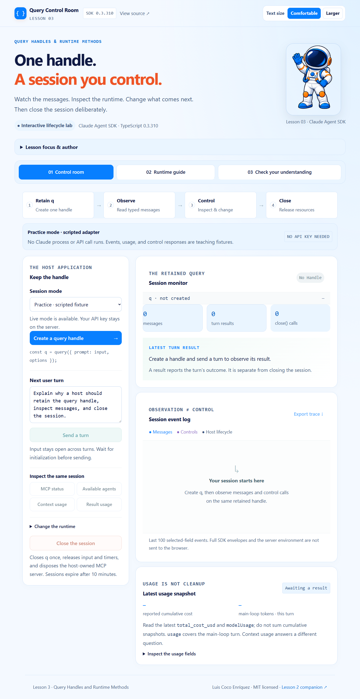
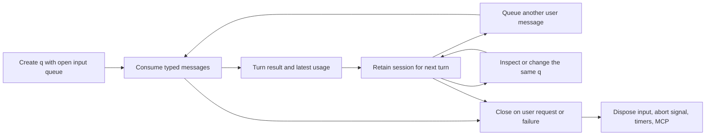

# Lesson 03 · Query Control Room

A hands-on companion to **Claude Agent SDK TypeScript version 0.3.310**, by Luis Coco Enríquez.

Keep one query handle, observe its stream, inspect and change the runtime, and close its resources deliberately. This sample follows **Lesson 3: Query Handles and Runtime Methods** and builds on [Lesson 1](https://github.com/luiscoco/claude-agent-sdk-lesson-01) and [Lesson 2](https://github.com/luiscoco/claude-agent-sdk-lesson-02).



## Visual style and reading controls

The interface follows the course reference apps: pale blue backgrounds, navy text, orange heading accents, blue controls, rounded panels, and the course astronaut mascot. The screenshot above shows the refreshed design.

| Reading element            | Default presentation                                             |
| -------------------------- | ---------------------------------------------------------------- |
| Body text                  | **21 px**, with comfortable line spacing                         |
| Labels and supporting text | Approximately **18–20 px** or larger                             |
| Code                       | Approximately **20 px**, wrapping within its panel               |
| Larger setting             | **24 px** base text, with scalable labels, controls and headings |

Use **Text size → Larger** in the page header when you need bigger text. Choose **Comfortable** to return to the default size. The choice is saved in this application's browser storage and remains after a reload; it makes no API request. Browser zoom is also available.

On phones and narrower windows, navigation and work areas stack so controls and text remain usable. You can open **Lesson focus & author** where that panel is available. Lesson activities, practice/live distinctions, permissions and server-side key handling continue to work as described below.

The shared presentation files are `src/client/course-theme.css` (palette and layout), `src/client/course-theme.ts` (reading preference and course presentation), and `public/course-astronaut.png` (reference mascot). See [visual style details](docs/visual-style.md) for the reference sources and a full-size screenshot.

### Update an existing checkout

Pull the latest changes and restart the local app:

```sh
git pull --ff-only
npm ci
npm run dev
```

Refresh the browser tab to load the updated interface. The lesson-specific local URL and first-run instructions are listed below.

## Run the application

Requirements: **Node.js 22.14+**, npm, Git, and a browser.

```sh
git clone https://github.com/luiscoco/claude-agent-sdk-lesson-03.git
cd claude-agent-sdk-lesson-03
npm ci
npm run dev
```

Open **http://127.0.0.1:4331**. The default practice mode needs no model account or API key.

1. Click **Create a query handle**, then **Send a turn**.
2. Watch `system`, `user`, `assistant`, and `result` events. The turn result leaves the session ready for another turn.
3. Inspect **Available agents**, **MCP status**, **Context usage**, and **Result usage**.
4. Open **Change the runtime**. Attach the course MCP server, inspect status, choose a next-response model, and send a second turn.
5. Compare the same handle ID and increasing turn count. Read the latest cumulative usage snapshot.
6. Click **Close the session**. Observe one close call and disabled session controls.

See the [classroom walkthrough and answer guide](docs/lesson-3-walkthrough.md) for a teaching sequence.

## Practice and live modes are explicit

| Mode                  | What actually runs                                                                                 | Credentials / cost                                                                                                           |
| --------------------- | -------------------------------------------------------------------------------------------------- | ---------------------------------------------------------------------------------------------------------------------------- |
| Practice, the default | A scripted async query adapter, the real host lifecycle controller, and local HTTP/UI code         | No key, no SDK subprocess, no model requests. Messages, control responses, tokens, models, and costs are fictional fixtures. |
| Live, optional        | The real `query()` handle from SDK **0.3.310**, an open input queue, and real SDK runtime controls | Your server-side Anthropic API key. Sending turns makes billable model requests.                                             |

The practice adapter is deliberately labeled in the UI, CLI output, and exported trace. It is useful for deterministic classroom exercises, not evidence of model behavior. Live failures never fall back to fixture answers. The UI stays local and uses polling to display selected host state; this is not a browser-SDK or SSE implementation.

## Map the lesson to the code

| Lesson concept                          | Implementation                                                                                                                                    |
| --------------------------------------- | ------------------------------------------------------------------------------------------------------------------------------------------------- |
| Retain the handle returned by `query()` | [live.ts](src/server/live.ts) creates one streaming-input query; [session.ts](src/server/session.ts) retains its runtime handle.                  |
| Consume typed messages                  | `Session.consume()` uses `for await` and narrows `msg.type` before reading result fields.                                                         |
| Separate observation and control        | Message, control, error, and host lifecycle events have distinct labels in the event log.                                                         |
| MCP discovery and changes               | The retained handle receives `mcpServerStatus()` and `setMcpServers()`. Only a bundled, read-only course-note server can be attached by this UI.  |
| Agent discovery                         | `supportedAgents()` inspects availability; it does not launch an agent.                                                                           |
| Plugin refresh                          | `reloadPlugins({ holdOnCacheImpact: true })` reports a held reload without forcing it. No arbitrary plugin paths can be submitted by the browser. |
| Runtime model selection                 | `setModel(id)` is exposed between turns, for subsequent responses. A runtime-accepted ID can still be unavailable from the provider.              |
| Context inspection                      | `getContextUsage({ detail: 'summary' })` displays a selected category breakdown, not billing.                                                     |
| Usage inspection                        | Latest result fields supply per-turn main-loop usage and cumulative query cost/model totals.                                                      |
| Cleanup                                 | `close()` is idempotent at the host boundary; disposal releases input, abort signal, timers, and the host-owned MCP server.                       |

## Important correction to the lesson's conceptual usage name

The lesson refers to `getUsage()`. **The installed 0.3.310 `Query` interface has no `getUsage()` method.** This sample does not invent it.

For the ordinary usage view, read the latest result:

```ts
if (msg.type === 'result') {
  latest = {
    cost: msg.total_cost_usd, // cumulative estimated query cost
    models: msg.modelUsage, // cumulative per-model query-pipeline totals
    turn: msg.usage, // this turn's main-agent-loop usage
  };
}
```

Replace the latest snapshot; **do not add cumulative snapshots together**. In a streaming-input query, result costs of $0.01 and $0.02 mean the latest reported cumulative cost is $0.02. Usage estimates are not billing statements. `modelUsage` includes query-pipeline subagent/sidechain calls; `usage` covers the main agent loop. Other helper calls can be excluded.

The package also declares `usage_EXPERIMENTAL_MAY_CHANGE_DO_NOT_RELY_ON_THIS_API_YET()`. Its explicit experimental status and transcript/plan-usage scope make it unsuitable as a quiet stand-in for the lesson's conceptual name. This application does not call it.

`getContextUsage()` answers a different question: what occupies the current context window. The sample requests summary detail; full detail can perform per-category token-count calls. Reading either view does not close the query.

## Why streaming input matters

Control methods such as `setModel()` require streaming input/output mode. This app supplies an `AsyncIterable<SDKUserMessage>` to `query()`, keeps its producer open, and continuously consumes the retained handle. The next user turn is pushed into that same input queue.

The runnable implementation is in [live.ts](src/server/live.ts), [input.ts](src/server/input.ts), and [session.ts](src/server/session.ts). The lifecycle has these responsibilities:



A single prompt string is useful for a one-shot query, but it is not the correct teaching setup for these active streaming-session controls.

## Optional live SDK session

Copy `.env.example` to `.env`, set **your own** `ANTHROPIC_API_KEY`, and restart the server. On PowerShell:

```powershell
Copy-Item .env.example .env
```

Set `ANTHROPIC_MODEL` only if you want to override the SDK default. Choose **Live · real SDK / model charges** in the UI, create a handle, and send a turn. Keep keys in the server environment; never paste them into the browser or commit `.env`.

The host uses a bundled inert workspace, disables built-in tools (`tools: []`), skips project/user setting sources, disables session persistence, and configures `permissionMode: 'dontAsk'`. The only custom tool this UI can attach returns course notes. Its exact name is auto-approved through `allowedTools`; that setting is an approval rule, not a general tool-availability restriction. Connection health does not establish tool permission. The configured `lifecycle-guide` subagent is discoverable; this app does not enable a built-in Agent tool to launch it.

`setMcpServers()` changes the application-managed dynamic set. Omitting a server does not universally remove settings-defined or plugin-owned servers. The UI offers only the bundled server and never accepts browser-supplied remote URLs, shell commands, or plugin paths.

The live configuration has `maxTurns: 4` and `maxBudgetUsd: 0.25`. Each turn also has a 90-second host timeout. Runtime controls have a 15-second timeout. Sessions close after 10 minutes, when replaced, on stream failure/end, on explicit close, or during graceful server shutdown. The browser sends a best-effort close on navigation; the server lifetime limit covers missed browser cleanup. A hard process kill cannot guarantee graceful disposal.

This is a local teaching host bound to `127.0.0.1`, with same-origin JSON request checks and a single current session. Opening another tab and creating a handle replaces the previous session. It is not designed as a multi-user hosted model service.

## Small CLI examples and verification

```sh
npm run demo:cli   # labeled scripted lifecycle, no model
npm run api:check  # verify pinned installed declarations and usage mapping
npm run check     # type checking, unit/API tests, production build
```

For production, run `npm run build`, then `npm start`. Open **http://127.0.0.1:4331**.

Browser tests build and start their own production server on **4332**:

```sh
npx playwright install chromium
npm run test:e2e
```

On Linux, use `npx playwright install --with-deps chromium` if needed. GitHub Actions runs Node.js 22/24 checks and Chromium browser tests. The tests exercise multiple turns, cancellation, one-time cleanup, failed controls, held reloads, timeouts, session replacement, HTTP boundaries, responsive layout, and the quiz. Automated tests use injected query handles and do not make model requests. A manual live run with claude-haiku-5-5 also verified initialization, one model turn, MCP attachment/status, agent discovery, and context inspection. Live execution requires a learner's own valid key and model access.

## Source map

- [src/server/session.ts](src/server/session.ts): retained handle, observation/control separation, latest usage, idempotent cleanup.
- [src/server/live.ts](src/server/live.ts): real SDK query configuration and streaming input.
- [src/server/practice.ts](src/server/practice.ts): explicitly fictional practice adapter.
- [src/server/app.ts](src/server/app.ts): local session routes, replacement, expiry, and control timeouts.
- [src/client/main.ts](src/client/main.ts): selected-state rendering, polling, user controls, trace export, and quiz.
- [docs/lesson-3-walkthrough.md](docs/lesson-3-walkthrough.md): student exercises and answers.

## Version references

- [Official TypeScript SDK reference](https://code.claude.com/docs/en/agent-sdk/typescript)
- [Official SDK 0.3.310 release](https://github.com/anthropics/claude-agent-sdk-typescript/releases/tag/v0.3.310)
- Installed `@anthropic-ai/claude-agent-sdk/sdk.d.ts`, especially `Query`, `SDKResultMessage`, and runtime control response types.

Online documentation evolves. The pinned package declarations are this sample's code contract.

MIT © Luis Coco Enríquez. Independent educational sample; not an official Anthropic product.

The live adapter uses q.initializationResult() to enable input after the control handshake. The first system/init stream event may arrive only after a user turn; it does not reset an already-running turn to ready.
